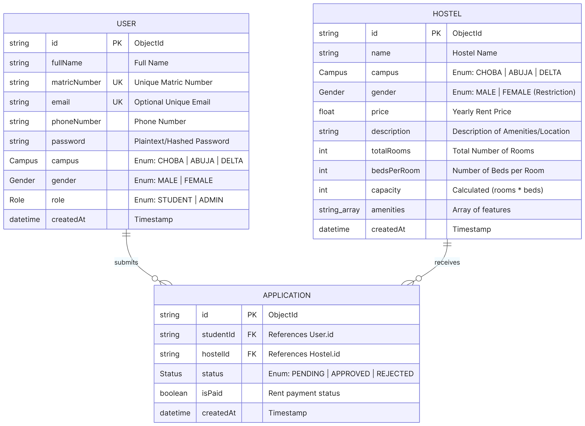
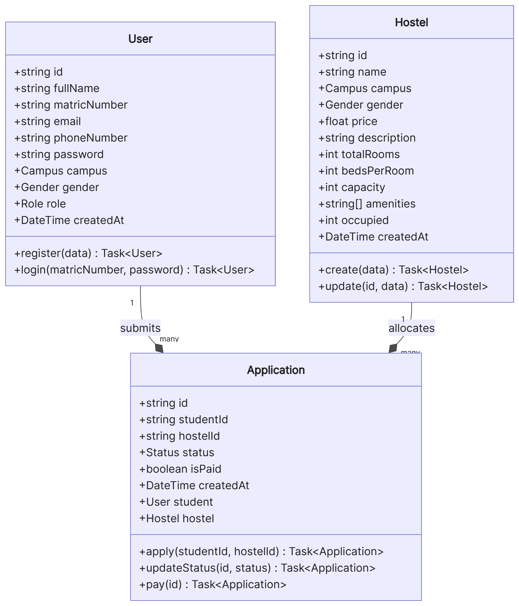
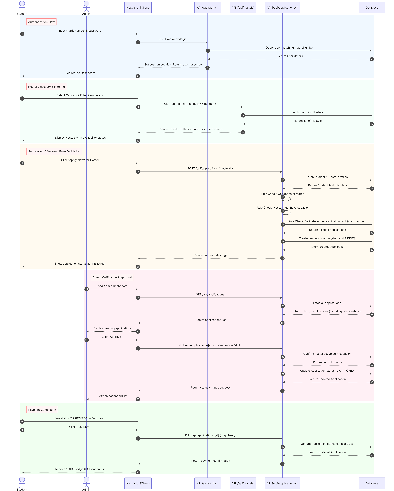

# 🏠 Uniport Hostel Portal

> A full-stack web application for managing student hostel allocation at the University of Port Harcourt (UNIPORT).  
> Submitted as a group assignment for **ECE 312 — Group 4**, Department of Electrical and Computer Engineering, University of Port Harcourt.

---

## 📌 Project Overview

The **Uniport Hostel Portal** is a digital platform that streamlines the student hostel application and allocation process. It replaces manual paper-based systems with a modern, role-based web application — submitted as a course assignment for **ECE 312** by **Group 4**.

The system serves two types of users:

- **Students** — browse available hostels, submit accommodation applications, and track their application status.
- **Administrators** — review and process student applications, manage hostel listings, and monitor all registered users across campuses.

---

## ✨ Features

### 🎓 Student Portal
- Secure registration and login with matric number
- Browse all available hostels filtered by campus and gender
- Submit hostel accommodation applications
- Real-time application status tracking (Pending / Approved / Rejected)
- Personalized student dashboard with profile summary

### 🛡️ Admin Dashboard
- Review and approve/reject student applications
- Full hostel directory with occupancy stats and amenity tags
- Create and publish new hostel entries
- View all registered users with role, campus, contact, and application count filters
- Live KPI metrics (total applications, pending, capacity fill rate)

---

## 🛠️ Tech Stack

| Layer | Technology |
|---|---|
| **Frontend** | Next.js 16, React 19, TypeScript |
| **Styling** | Tailwind CSS v4 |
| **Icons** | Lucide React |
| **Backend** | Next.js API Routes (App Router) |
| **Database** | MongoDB (via Prisma ORM) |
| **ORM** | Prisma 6 |
| **Runtime** | Node.js |

---

## 🚀 Getting Started

### Prerequisites
- [Node.js](https://nodejs.org/) v18 or higher
- [pnpm](https://pnpm.io/) (recommended) or npm
- A MongoDB connection string (local or [MongoDB Atlas](https://www.mongodb.com/atlas))

### 1. Clone the repository
```bash
git clone https://github.com/ifedayoprince/uniport-hostel-portal.git
cd uniport-hostel-portal
```

### 2. Install dependencies
```bash
pnpm install
# or
npm install
```

### 3. Configure environment variables
Create a `.env` file in the project root:
```env
DATABASE_URL="mongodb+srv://<username>:<password>@cluster.mongodb.net/uniport_hostel"
```

### 4. Push the database schema
```bash
npx prisma db push
```

### 5. (Optional) Seed the database
```bash
pnpm db:seed
# or
npm run db:seed
```

### 6. Start the development server
```bash
pnpm dev
# or
npm run dev
```

Open [http://localhost:3000](http://localhost:3000) in your browser.

---

## 📊 System Architecture & Diagrams

The system architecture and database relationships are documented below:

### Entity Relationship Diagram (ERD)


### Class Relationship Diagram (CRD)


### Hostel Application Lifecycle Sequence Diagram


---

## 📁 Project Structure

```
uniport-hostel-portal/
├── prisma/
│   ├── schema.prisma        # Database models (User, Hostel, Application)
│   └── seed.ts              # Database seeder
├── src/
│   └── app/
│       ├── page.tsx          # Landing / Home page
│       ├── login/            # Login page
│       ├── register/         # Student registration page
│       ├── student/          # Student dashboard
│       ├── admin/            # Admin dashboard
│       └── api/
│           ├── auth/         # Login, logout, register endpoints
│           ├── hostels/      # Hostel CRUD endpoints
│           ├── applications/ # Application endpoints
│           └── users/        # Admin-only user listing endpoint
└── public/                   # Static assets
```

---

## 📄 License

This project is developed strictly for academic purposes as a coursework submission for ECE 312.  
© 2026 University of Port Harcourt — Department of Electrical and Computer Engineering.
