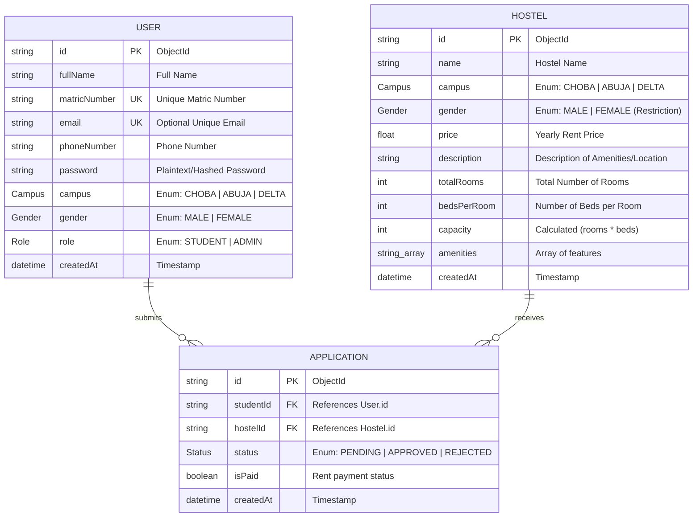
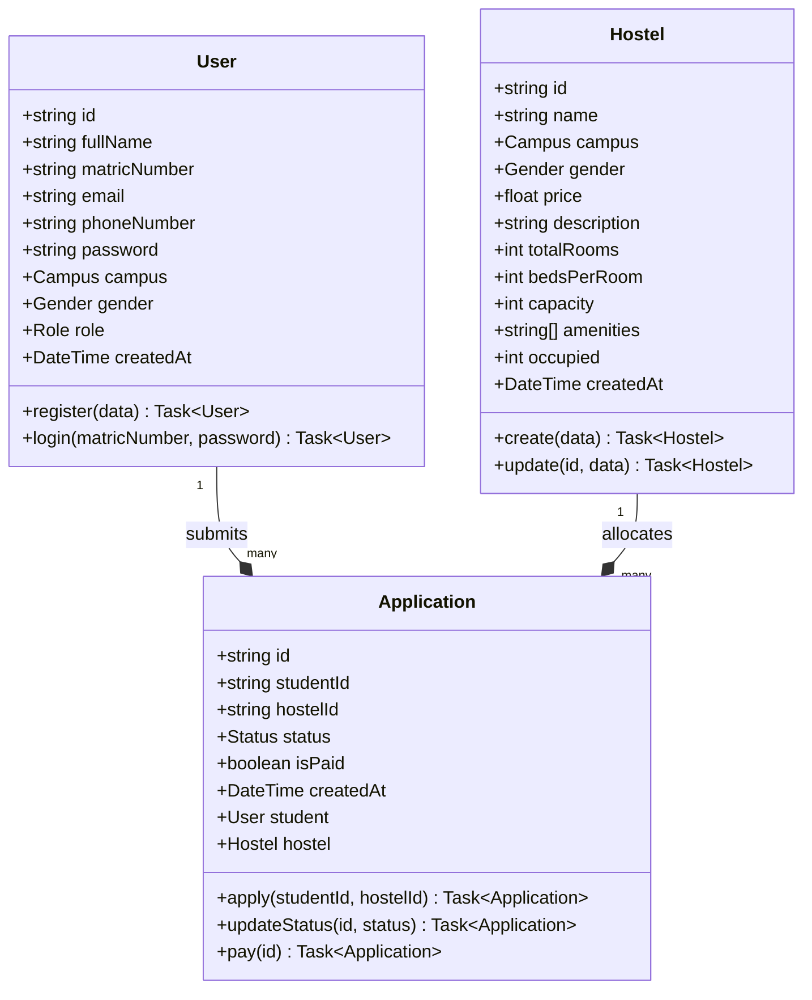
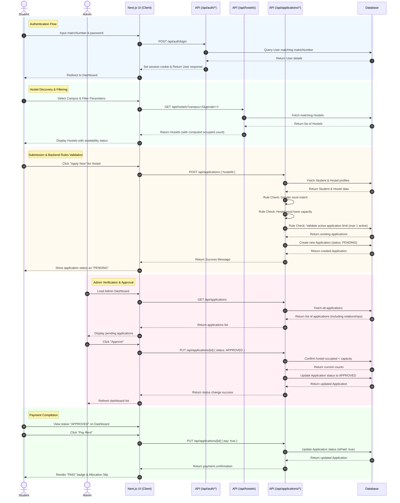

# System Architecture Diagrams

This document contains the visual architecture diagrams for the **Uniport Hostel Portal** project. The diagrams are represented using **Mermaid.js** syntax and cover the Database Entity Relationship, System Classes/Interfaces, and the E2E Application Workflow.

---

## 1. Entity Relationship Diagram (ERD)

This diagram details the underlying database structure and data constraints, reflecting the `schema.prisma` configurations (supporting both MongoDB and the local JSON database).

---

## 2. Class Relationship Diagram

This diagram represents the logical code relationships in the system, focusing on data structures and operations available on each entity.

---

## 3. Sequence Diagram (Hostel Application Lifecycle)

This sequence diagram illustrates the lifecycle of a student applying for a hostel, the backend validation, approval by an admin, and final simulated payment.

